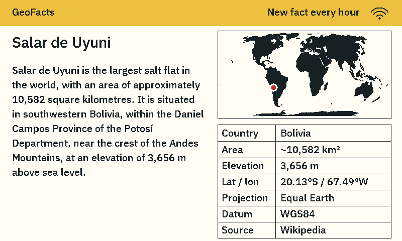

# Badge GeoFacts

Geography, GIS and Earth-observation field notes for the **Espruino ESP32-C3 ePaper Badge, production revision 1.2**. It attempts to fetch a new online entry every **hour** when connected, with a bitmap world map marking the subject's location.



## What appears on the badge

- A warm gold **GeoFacts** header with a **Wi-Fi icon** and **“New fact every hour.”** The icon reflects connectivity at the last screen refresh; it is not an instant or power-status indicator.
- The cadence label is fixed. There is no ticking countdown. Full panel refreshes occur for fact/setup changes and some Wi-Fi state changes; reconnecting can redraw the same fact without advancing it.
- A readable IBM Plex Sans font with complete glyph bounds, Latin accents, degree signs and normal W/w characters.
- One or two **complete source sentences**, selected to fit the actual display. Parenthetical and square-bracketed text is removed, including many pronunciations, citations and alternative unit conversions. Sentences are never cut off or replaced by an ellipsis. An entry with no complete sentence that fits is skipped.
- A thin-bordered world bitmap top-aligned with the fact title and a red location marker. Beneath it, a plain high-contrast table aligns labels and values with solid black row and column dividers. It can include a country/region, up to two extracted measurements, coordinates, projection, datum and source.
- Measurements come from the article already downloaded, so the table adds no network requests. Recognized units and qualifiers such as “approximately” or “up to” are retained. Country/region matching and measurement labeling are best-effort text rules, not authoritative structured metadata: they can miss or misclassify unusual wording. Consult the linked article for the original context. The table uses one readable text size for labels and values, with no decorative title or accent bar. Long values wrap rather than shrink; low-priority metadata may be omitted only when needed to keep the text readable. Button instructions and connection URLs stay off the normal fact card.

The entries come from current English Wikipedia summaries, fetched over certificate-verified HTTPS from a pool of 80 geographic features and Earth-observation locations. The subject pool eventually repeats. The concise display text is an **extractive summary**, not an AI-generated claim. The local page shows the longer saved excerpt (up to 1,799 bytes) and a link to the full source article. No API key or paid model is required.

## Controls

| Control | Action |
| --- | --- |
| Side button | Fetch another fact now. A successful download restarts the one-hour interval. |
| Rear SHARE | Hold for 3 seconds to open Wi-Fi setup. Tap to close setup and return to facts, reconnecting to saved Wi-Fi if configured. A tap while already disconnected also retries saved Wi-Fi. Holding again closes setup. |
| USB | Always available for firmware updates; this app does not require the original conference app's SHARE-to-connect sequence. |

A panel refresh takes about **13 seconds**, plus download time. Each source request allows up to 45 seconds, and one update can try up to four topics. DNS lookup, clock synchronization and retries can make the total update take longer. Several quick presses during an update queue **one additional fetch**, rather than a separate fetch for every press.

When Wi-Fi is unavailable, the badge keeps its last saved fact. If no entry has been cached yet, it shows a built-in Okavango Delta example. Pressing the side button while in setup mode shows that offline fact and map. Hold SHARE to open setup; tap it to leave setup and resume the saved connection.

## Scheduling

The default interval is **3,600 seconds**, configured once in `main/config.h`. Only an expired interval or an explicit side-button request advances the topic. Wi-Fi reconnection, SHARE setup exit, clock synchronization and reboot do not force a different fact. If the deadline has already passed, the next connected loop can fetch the overdue entry. First-run initialization without a cached entry also fetches as soon as it can.

Each successful download starts a fresh one-hour interval. A manual fetch restarts that hour. A scheduled fetch failure preserves the current entry and waits five minutes before its next automatic retry. A failed manual fetch does not move the existing automatic deadline, but automatic retries still honor the five-minute backoff; another button press may retry sooner. The last successful fetch time is saved in NVS so a restart restores the remaining interval after network time becomes available. If a valid saved timestamp exists but the clock is not yet set, the badge uses a provisional interval until clock synchronization restores the remaining time. If the saved timestamp itself is missing, the cached entry starts with a full interval from boot.

When upgrading from the previous four-hour build, the last successful fetch time is derived from its saved deadline. The new hour is measured from that same fetch, so an already-overdue entry may update soon after upgrade.

## First Wi-Fi connection

1. Power the badge by USB and wait for its setup screen.
2. Join **GeoFacts-XXXX** from a phone or computer, using the password shown on the badge. Remain connected if the phone reports that the network has no internet.
3. Open **http://192.168.4.1**.
4. Enter the exact name and password of a **2.4 GHz personal Wi-Fi network**, then click **Save and connect**.
5. The setup network closes while the badge connects. Rejoin your usual Wi-Fi. The badge fetches a fact and refreshes the panel.

This app uses **either setup access-point mode or client mode**, following Espruino's ESP32-C3 connection handling; this is an application choice, not a claim that the chip cannot support combined modes. It never leaves both active during a connection attempt. The app checks that the Wi-Fi driver accepted the saved settings, makes three connection attempts, and allows time for DHCP. If a configured network is temporarily unavailable, the badge keeps the saved fact visible and retries quietly after 30 seconds; it does not replace the fact with setup instructions. Hold SHARE when you actually want to edit settings.

“Saved” or “Credentials uploaded” means the settings were written, not that the network accepted the password. A `4WAY_HANDSHAKE_TIMEOUT` is a failure during the WPA2 password exchange. Compare the password with a device already connected to the same network before assuming incompatibility.

Enterprise username/password authentication and browser-based captive portals are not implemented. Credentials are stored only in the badge's local NVS flash. No credentials are compiled into the distributed firmware. The temporary setup network uses WPA2, changes its password after restart, and closes 15 minutes after it is opened, even if a client is still connected. On timeout, the badge restores its saved Wi-Fi automatically. A tap of SHARE also exits setup and restores the saved connection. USB reconnects independently and never requires holding SHARE in this firmware.

The badge contacts `en.wikipedia.org`, uses network-provided DNS with `1.1.1.1` as a fallback, and synchronizes its clock through `pool.ntp.org` / `time.cloudflare.com` before validating HTTPS certificates. It keeps Wi-Fi and USB awake and is intended for **USB-powered use**; battery runtime has not been optimized.

## Local fact page

From another device on the same network, open the IP address assigned to the badge by your router. The address is also printed on the USB diagnostic console.

| Route | Content |
| --- | --- |
| `/` | Current fact, full saved excerpt, source attribution and map; Wi-Fi setup when accessed through setup Wi-Fi. |
| `/api/fact` | Title, concise summary, longer excerpt, source URL, coordinates, Wi-Fi state and live next-update countdown. |
| `/world.bmp` | A standard 1-bit base world bitmap. The page overlays the subject marker. |

Some managed networks isolate client devices and prevent access to this page. The badge can still fetch and show facts itself. The marker shows the **subject's location**, not the publisher's location. Large geographic features use one reference point. The bitmap uses **Equal Earth on WGS84 (EPSG:8857)**. This equal-area projection preserves relative areas; it does not preserve all shapes or distances. The land bitmap and subject marker use the same transformation, fitted without stretching the map axes.

## Install or update

**Hardware:** ESP32-C3, 4 MB flash, 800 × 480 four-color panel, maker's production rev 1.2 pin mapping. Other boards require a port.

### Browser

1. Connect with a USB data cable. Close competing serial apps or badge tabs.
2. If the badge still runs its original conference app, hold SHARE until its LEDs stay solid blue, then release.
3. Open [Espressif ESP Tool](https://espressif.github.io/esptool-js/) in desktop Chrome or Edge and select the badge's USB serial/JTAG port. Confirm ESP32-C3; leave WebUSB (CH340) unchecked.
4. Choose the appropriate file and address:

| File | Address | Purpose |
| --- | --- | --- |
| `firmware.bin` | **`0x0`** | Complete factory image. Replaces the flash layout, Wi-Fi settings and saved app data. |
| `application.bin` | **`0x10000`** | Update an existing Badge GeoFacts 1.x installation while retaining Wi-Fi settings and cached fact. |

5. Keep flash mode/frequency/size set to **keep** and leave **Erase all** unchecked. Click **Program** and wait for verification/reset.

Only use the application-only update on an existing Badge GeoFacts installation with the included partition layout. When replacing original Espruino or another app, use the full image and back up first.

An old image can remain visible after reset because ePaper retains its pixels. Allow a refresh to finish. If necessary, reconnect USB once.

### Terminal

These macOS/Linux shell examples use **esptool 4.13.0** syntax. Esptool 5 uses hyphenated command/option names. Replace `PORT` with the badge's serial device. Create a local environment before installing the pinned utility:

```sh
python3 -m venv .venv
. .venv/bin/activate
python -m pip install esptool==4.13.0

# Full installation; replaces saved settings/data.
python -m esptool --chip esp32c3 --port PORT --baud 460800 \
  --before usb_reset --after hard_reset write_flash 0x0 firmware.bin

# Update an existing Badge GeoFacts installation; retains NVS settings.
python -m esptool --chip esp32c3 --port PORT --baud 460800 \
  --before usb_reset --after hard_reset write_flash 0x10000 application.bin
```

## Backup and restore

A full device backup may contain photos, contacts, Wi-Fi credentials and other saved data. **Keep backups under `private/backups/` and never publish them.** Use the esptool environment from the Terminal section above. This directory is ignored by `.gitignore` and is not created by a fresh clone. Create it before reading flash. Use new filenames if a backup already exists; never overwrite the original-state backup with a later modified state.

```sh
# Create local-only backup directories; do not overwrite an existing original.
mkdir -p private/backups
chmod 700 private private/backups

# Read all 4 MB before replacing another badge's firmware.
python -m esptool --chip esp32c3 --port PORT --baud 460800 \
  --before usb_reset --after hard_reset \
  read_flash 0x0 0x400000 private/backups/original-badge.bin

# Read again to a different filename and compare SHA-256 hashes.
python -m esptool --chip esp32c3 --port PORT --baud 460800 \
  --before usb_reset --after hard_reset \
  read_flash 0x0 0x400000 private/backups/original-badge-verify.bin
shasum -a 256 private/backups/original-badge*.bin

# Restore a complete backup to the same badge.
python -m esptool --chip esp32c3 --port PORT --baud 460800 \
  --before usb_reset --after hard_reset \
  write_flash 0x0 private/backups/original-badge.bin
```

Verify recovery backups with two independent reads and keep their checksums privately. Firmware updates do not program eFuses.

## Build

Use **ESP-IDF v5.5.1**, ESP32-C3, and RISC-V GCC **14.2.0_20241119**. From this directory, after activating official ESP-IDF (its Python environment must provide the esptool 4.x syntax used below):

```sh
idf.py set-target esp32c3
idf.py build
cp build/badge_geofacts.bin application.bin
python -m esptool --chip esp32c3 merge_bin \
  -o firmware.bin --flash_mode dio --flash_freq 40m --flash_size 4MB \
  --fill-flash-size 4MB \
  0x0 build/bootloader/bootloader.bin \
  0x8000 build/partition_table/partition-table.bin \
  0x10000 application.bin
```

A clean build and merge were checked with the pinned ESP-IDF/toolchain. Byte-for-byte reproduction of the checked-in binaries across other environments is not guaranteed. If you intend to commit rebuilt images or changed source, update the corresponding hashes in `release.json` and `SHA256SUMS` before running the publication guard; rebuilding alone does not refresh those records.

| File | Responsibility |
| --- | --- |
| `main/app_main.c` | Subject pool, HTTPS reader, Wi-Fi setup and buttons. |
| `main/scheduler.c` | Monotonic deadlines, persisted-time recovery and fetch retry policy. |
| `main/config.h` | Default automatic fact interval. |
| `main/summary.c` | Selects complete source sentences and verifies that they fit. |
| `main/details.c` | Builds conservative source-based location and measurement rows. |
| `main/display.c` | Typography, compact GeoFacts header, projection label and world marker. |
| `main/epaper.c` | Panel protocol and rev 1.2 pins. |
| `main/projection.c` | Equal Earth / WGS84 transformation shared by the bitmap generator, marker and local-page coordinates. |
| `main/font.h`, `main/world.h` | Ready-to-build bitmap assets. |

The supplied font is openly licensed and bundled under `assets/fonts/`. To regenerate its glyph atlas or run summary/layout regressions and framebuffer previews:

```sh
python -m pip install -r requirements-dev.txt
python tools/generate_font.py
python tools/check_display.py
python tools/check_schedule.py
```

For numerical verification against PROJ, run `python tools/check_projection.py` after installing `requirements-dev.txt` (which already includes `pyproj`). The test checks control points including poles and the antimeridian.

`tools/generate_assets.py` takes a local land GeoJSON path as its required argument, for example `python tools/generate_assets.py /path/to/ne_110m_land.geojson`. It regenerates the Equal Earth land bitmap, without graticules or country borders, from [Natural Earth's 1:110m land GeoJSON](https://github.com/nvkelso/natural-earth-vector/blob/master/geojson/ne_110m_land.geojson). Preview fixtures include the source URLs for attribution. The checked-in assets are sufficient to build without downloading additional visual assets.

## Original Espruino software

Stock Espruino provides [`Badge.connectWiFi()`](https://www.espruino.com/Badge#api-calls), configured through `wifi.json` and the official [WiFi Credentials app](https://espruino.github.io/BadgeApps/?id=wifi). This project is a native ESP-IDF application, following the native structure of [BadgeImageGen](https://huggingface.co/utkucoban/BadgeImageGen). Restore the original firmware backup before using the Espruino App Loader; it does not manage this native app.

## Licensing and publication

- Project code follows the included MIT license. The adapted `epaper.c` driver retains its MPL 2.0 notice; source and `MPL-2.0.txt` are included.
- Display driver origin: Gordon Williams / Pur3 Ltd, [Espruino ePaper Badge](https://github.com/espruino/Espruino/blob/master/libs/js/misc/epaper_badge.js), adapted by BadgeImageGen.
- IBM Plex Sans: SIL Open Font License 1.1; copyright and license are bundled in `assets/fonts/OFL.txt`.
- Wikipedia excerpts and extractive summaries retain their contributors' [CC BY-SA licensing](https://en.wikipedia.org/wiki/Wikipedia:Copyrights). The badge credits Wikipedia; the local page links to the source article and contributor history.
- Natural Earth data is public domain. Equal Earth equations follow Šavrič, Patterson & Jenny (2018), [DOI:10.1080/13658816.2018.1504949](https://doi.org/10.1080/13658816.2018.1504949), and were checked against [PROJ](https://proj.org/en/stable/operations/projections/eqearth.html). PROJ’s notice is included in `assets/PROJ-COPYING.txt`. ESP-IDF and its dependencies retain their own licenses.

See [PUBLICATION.md](PUBLICATION.md) for local review, the pre-commit publication guard and private-backup handling. Keep `private/`, device backups, credentials and personal diagnostic logs out of any future commit or upload. The distributed `firmware.bin` and `application.bin` are clean factory/build images with no stored network credentials. Third-party attribution is summarized in [NOTICE.md](NOTICE.md).
